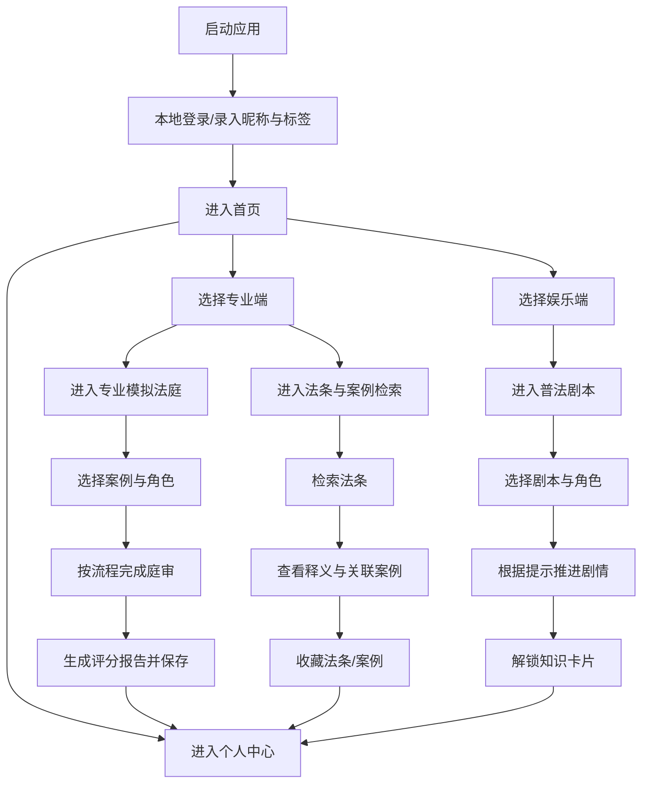

## 1. 产品概述

本项目是一个仅支持本地部署运行的简易法律互动应用，用于快速展示“专业模拟法庭 + 法条案例检索 + 轻量普法剧本 + 个人成长记录”闭环。

* 面向法学生与普通用户，分别提供专业端与娱乐端入口，以最少层级完成登录、体验、记录、收藏与复盘。

* 产品目标是在 Windows/macOS 本地电脑端稳定运行，不依赖云端服务，优先保证演示效果、流程清晰与核心功能可用。

## 2. 核心功能

### 2.1 用户角色

| 角色   | 注册方式     | 核心权限                                      |
| ---- | -------- | ----------------------------------------- |
| 法学生  | 本地账号密码录入 | 可登录、选择专业端/娱乐端、参与模拟法庭、检索法条案例、体验普法剧本、查看成长记录 |
| 普通用户 | 本地账号密码录入 | 可登录、选择专业端/娱乐端、参与基础体验、收藏内容、查看个人记录          |

### 2.2 功能模块

1. **登录页**：本地账号密码登录、昵称录入、用户标签选择。
2. **首页**：专业端/娱乐端双入口、四个核心功能快捷按钮、最近记录概览。
3. **专业模拟法庭页**：案例筛选、角色选择、流程引导、环节操作、评分报告生成与保存。
4. **法条与案例检索页**：法条关键词检索、法条原文与简易释义展示、关联案例展示、法条/案例收藏。
5. **普法剧本页**：生活场景剧本选择、引导模式推进、1-2 人角色扮演、知识卡片解锁。
6. **个人中心页**：基础信息、角色段位、成就勋章、历史记录、收藏记录、账号修改与数据清理。

### 2.3 页面详情

| 页面名称     | 模块名称    | 功能说明                                  |
| -------- | ------- | ------------------------------------- |
| 登录页      | 登录表单    | 支持账号、密码、本地校验；首次使用可直接录入昵称与用户标签         |
| 登录页      | 用户信息初始化 | 设置昵称、标签（法学生/普通用户），本地持久化               |
| 首页       | 双入口面板   | 提供专业端、娱乐端入口说明，帮助用户快速理解使用场景            |
| 首页       | 快捷功能区   | 展示案例模拟、法条检索、普法剧本、个人中心四个按钮             |
| 首页       | 最近记录    | 展示最近参与的庭审、最近体验的剧本、最近收藏内容摘要            |
| 专业模拟法庭页  | 案例库     | 本地预置民事/刑事/商事案例，各不少于 10 条，以案例编号与基础信息展示 |
| 专业模拟法庭页  | 案由筛选    | 按民事/刑事/商事及案由关键词筛选案例                   |
| 专业模拟法庭页  | 角色选择    | 支持法官、原告律师、被告律师、公诉人、证人等角色选择            |
| 专业模拟法庭页  | 庭审流程    | 按“开庭→调查→辩论→宣判”顺序推进，每环节提供文字引导          |
| 专业模拟法庭页  | 评分报告    | 按法条引用、辩论逻辑、程序合规生成简易评分，并本地保存           |
| 法条与案例检索页 | 法条库     | 本地存储《民法典》《刑法》等核心法条，支持关键词检索            |
| 法条与案例检索页 | 法条详情    | 展示法条原文、简易释义、所属法域与关联标签                 |
| 法条与案例检索页 | 案例关联    | 根据法条匹配本地案例，展示核心背景与裁判结果                |
| 法条与案例检索页 | 收藏功能    | 支持收藏法条与案例，并在个人中心查看                    |
| 普法剧本页    | 剧本列表    | 预置 8-10 个生活法律场景剧本，例如租房、劳动仲裁、遗产继承      |
| 普法剧本页    | 引导模式    | 以线索提示驱动流程，仅支持引导模式，不做开放式 AI 对话         |
| 普法剧本页    | 角色扮演    | 支持 1-2 人本地角色分配与流程推进，聚焦证据搜集与简单辩论       |
| 普法剧本页    | 知识卡片    | 完成剧本后解锁基础法律知识卡片，并在本地展示与留存             |
| 个人中心页    | 用户档案    | 展示昵称、标签、当前段位、勋章墙                      |
| 个人中心页    | 段位系统    | 提供 9 级段位，从青铜到王牌大律师                    |
| 个人中心页    | 成就系统    | 提供 10+ 基础勋章，按参与次数、收藏、完成剧本等条件解锁        |
| 个人中心页    | 历史记录    | 展示参与过的庭审、剧本体验记录与评分结果                  |
| 个人中心页    | 收藏记录    | 展示收藏的法条与案例                            |
| 个人中心页    | 设置功能    | 支持账号信息修改与本地数据清理                       |

## 3. 核心流程

用户首次进入应用后，通过本地账号密码完成登录，并补充昵称与标签。进入首页后可选择专业端或娱乐端，再通过四个快捷入口进入具体功能页面。专业模拟法庭完成案例筛选、角色分配、流程推进与评分留存；法条检索支持法条与案例联动及收藏；普法剧本完成情景引导与知识卡片解锁；所有结果最终回流到个人中心形成闭环。

## 4. 用户界面设计

### 4.1 设计风格

* 主色：深蓝灰、象牙白、少量金铜色点缀，形成专业法律产品质感

* 按钮样式：扁平化圆角矩形，强调清晰层级与桌面端点击效率

* 字体与字号：中文优先使用高可读性衬线标题搭配清晰无衬线正文字体，标题突出专业感，正文注重密度控制

* 布局风格：桌面优先的顶部导航 + 左右分区内容布局，核心模块卡片化展示

* 图标风格：简洁线性图标，避免娱乐化夸张表达

### 4.2 页面设计概览

| 页面名称     | 模块名称  | UI 元素                           |
| -------- | ----- | ------------------------------- |
| 登录页      | 登录表单  | 居中卡片、品牌标题、账号密码输入框、昵称与标签选择器      |
| 首页       | 双入口面板 | 左右双列入口卡片、场景说明、快捷按钮网格、最近记录卡片     |
| 专业模拟法庭页  | 庭审主界面 | 左侧案例与角色配置区、右侧流程时间线、底部操作区、结果面板   |
| 法条与案例检索页 | 检索主界面 | 顶部搜索栏、左侧法条列表、右侧法条详情与关联案例卡片      |
| 普法剧本页    | 剧本体验区 | 剧本卡片列表、线索步骤区、角色状态栏、知识卡片弹层       |
| 个人中心页    | 成长档案区 | 用户资料卡、段位进度条、勋章墙、历史记录表、收藏列表、设置按钮 |

### 4.3 响应式设计

* 采用桌面优先设计，适配常规电脑端分辨率

* 最低满足常见笔记本宽度下正常浏览与操作

* 在较窄窗口下，双栏内容自动切换为上下结构，但不以移动端为目标

