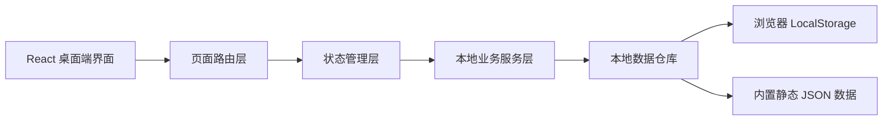
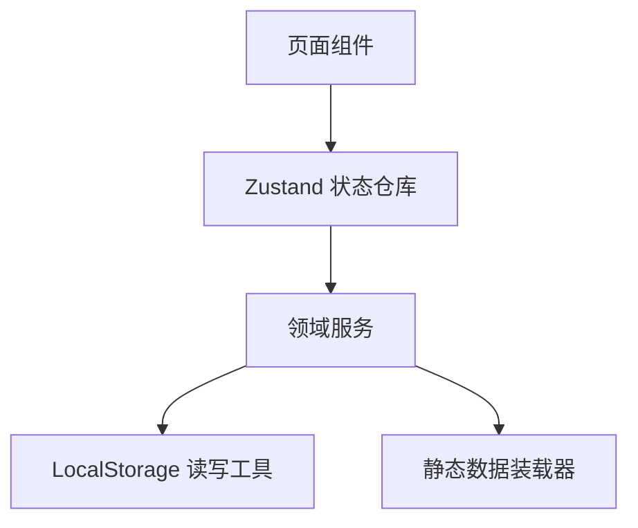
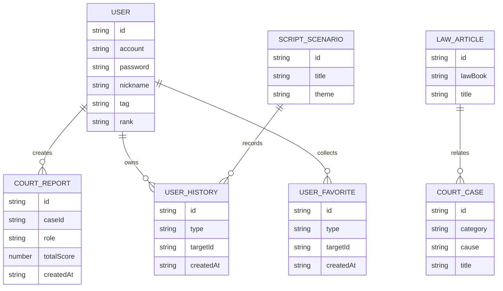

## 1. 架构设计


## 2. 技术说明
- 前端：React 18 + TypeScript + Vite
- 样式：Tailwind CSS 3
- 路由：React Router
- 状态管理：Zustand
- 本地数据：LocalStorage + 静态 JSON 资源文件
- 运行方式：纯前端本地运行，不接入后端、不接入数据库、不接入任何外部服务
- 适配目标：Windows/macOS 常规电脑浏览器本地访问

## 3. 路由定义
| 路由 | 作用 |
|------|------|
| /login | 本地登录与用户信息录入 |
| /home | 首页与双入口选择 |
| /court | 专业模拟法庭 |
| /search | 法条与案例检索 |
| /scripts | 普法剧本 |
| /profile | 个人中心 |

## 4. API 定义
本项目不设置真实后端 API，采用前端本地服务函数封装数据读写逻辑。

```ts
type UserProfile = {
  id: string;
  account: string;
  password: string;
  nickname: string;
  tag: "法学生" | "普通用户";
  rank: string;
  achievements: string[];
};

type CourtCase = {
  id: string;
  category: "民事" | "刑事" | "商事";
  cause: string;
  title: string;
  summary: string;
  result: string;
  relatedLawIds: string[];
};

type LawArticle = {
  id: string;
  lawBook: string;
  title: string;
  content: string;
  interpretation: string;
  keywords: string[];
  relatedCaseIds: string[];
};

type ScriptScenario = {
  id: string;
  title: string;
  theme: string;
  roles: string[];
  clues: string[];
  steps: string[];
  knowledgeCards: string[];
};

type CourtReport = {
  id: string;
  caseId: string;
  role: string;
  scoreLawCitation: number;
  scoreLogic: number;
  scoreProcedure: number;
  totalScore: number;
  summary: string;
  createdAt: string;
};
```

## 5. 服务架构说明
本项目采用单体前端架构，不拆分服务端。业务逻辑按“页面组件 -> 状态仓库 -> 本地服务 -> 本地存储”进行分层，避免页面直接操作存储，提高可维护性。



## 6. 数据模型
### 6.1 数据模型定义


### 6.2 数据定义语言
本项目不使用 SQL 数据库，以下为本地存储键设计：

```text
localStorage keys
- law-game-user
- law-game-session
- law-game-court-reports
- law-game-history
- law-game-favorites
- law-game-script-progress
```

初始静态数据文件规划：

```text
src/data/cases.json
src/data/laws.json
src/data/scripts.json
src/data/achievements.json
src/data/ranks.json
```
